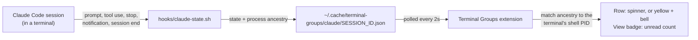

# Terminal Groups

A VS Code / Cursor extension that lists your terminals grouped by workspace folder, in a tree that sits next to the terminal panel. Built for multi-root workspaces with a lot of terminals open. With an optional Claude Code hook, it also shows which Claude sessions are waiting on you.

## Why

- A multi-root workspace with dev servers, shells, and a few Claude sessions per repo turns the built-in terminal list into 15+ flat rows. Here each repo gets its own folder.
- When several Claude sessions run in parallel, you can't tell which one finished or is stuck on a permission prompt without clicking through each. Here they turn yellow until you look at them, and the view badge counts them.
- Nothing to migrate. Your `tasks.json` keeps launching terminals as before, and their icons and colors carry over.

Skip it if you usually have only a few terminals open. The built-in list is fine for that.

## Quick start

Requires Node and pnpm.

```sh
git clone https://github.com/jnarowski/terminal-groups-vscode-extension.git
cd terminal-groups-vscode-extension
pnpm run install-local   # packages a .vsix and installs it into Cursor
```

Reload the window. The Terminals tree appears next to the terminal panel. Then hide the built-in tab list so you don't see both, in your user or workspace settings:

```jsonc
"terminal.integrated.tabs.enabled": false
```

For the Claude highlighting, add the hook (see [Claude Code attention](#claude-code-attention-optional-experimental)).

## Features

- Terminals grouped under their project folder. The workspace root is pinned on top and catches anything that doesn't belong to a project.
- Icons and colors come from each task's `icon` in `tasks.json`.
- Click to switch. Hover for a trash icon. Right-click to rename, change color or icon, split, or move to the editor area.
- Drag to reorder terminals inside a folder.
- Folder sort: workspace order (default), alphabetical, or manual (drag folders).
- `+` on a folder opens a new shell in that project.
- Search across all terminals, plus expand all / collapse all.
- Filter: all, needs you, Claude sessions, other terminals.
- Task exit markers (check or error) when a task's process ends.
- Optional: Claude Code sessions that finish or need permission get highlighted until you look at them (see below).

## Install notes

For VS Code instead of Cursor, run `pnpm run package` and then `code --install-extension terminal-groups.vsix --force`. To update, `git pull` and run the install command again, then reload.

Terminals sit one `workbench.tree.indent` step (default 8px) right of their folder icon. That setting is shared by every tree in the editor, so the extension leaves it alone.

On first launch the view moves itself into the Terminal panel. If it doesn't, drag the "Terminal Groups" tab onto the Terminal tab.

## Claude Code attention (optional, experimental)

The extension works without this. With it, a Claude session shows a spinner while working. When it finishes or asks for permission while you're on another terminal, the row and its folder turn yellow, a bell appears, and the view badge counts it. Viewing the terminal clears it.

### How it works



- Claude Code runs the hook on each event. The hook records `working` or `needs` plus the chain of parent process IDs, which leads back to the terminal's shell.
- The extension reads those files and marks the matching terminal. A `needs` state stays unread until you view that terminal. If you're already looking at it when Claude finishes, it never shows as unread.
- Files from sessions whose Claude process has exited are ignored, so nothing goes stale.

### Setup

Add these entries to the `hooks` object in `~/.claude/settings.json`, pointing at your clone. They coexist with hooks you already have: Claude Code runs every entry in an event's list, and this script always exits 0 without printing, so it never blocks or changes anything.

If you don't have a `hooks` object yet, use this as is. If you do, don't paste over it. Add each entry to the matching event's list, or add the event if it's missing. For example, an existing `Stop` hook becomes:

```json
"Stop": [
  { "hooks": [{ "type": "command", "command": "your-existing-stop-hook.sh" }] },
  { "hooks": [{ "type": "command", "command": "sh /path/to/terminal-groups/hooks/claude-state.sh needs", "timeout": 5 }] }
]
```

The full set:

```json
"hooks": {
  "UserPromptSubmit": [{ "hooks": [{ "type": "command", "command": "sh /path/to/terminal-groups/hooks/claude-state.sh working", "timeout": 5 }] }],
  "PostToolUse":      [{ "hooks": [{ "type": "command", "command": "sh /path/to/terminal-groups/hooks/claude-state.sh working", "timeout": 5 }] }],
  "Stop":             [{ "hooks": [{ "type": "command", "command": "sh /path/to/terminal-groups/hooks/claude-state.sh needs", "timeout": 5 }] }],
  "Notification":     [{ "hooks": [{ "type": "command", "command": "sh /path/to/terminal-groups/hooks/claude-state.sh needs", "timeout": 5 }] }],
  "SessionEnd":       [{ "hooks": [{ "type": "command", "command": "sh /path/to/terminal-groups/hooks/claude-state.sh end", "timeout": 5 }] }]
}
```

The hook writes one small JSON file per session to `~/.cache/terminal-groups/claude/`. The extension matches it to a terminal by process ancestry. To turn it off, remove the hooks. Already-running sessions may need a restart to pick them up.

## Troubleshooting

**The built-in terminal tab list still shows next to the tree.** Set `"terminal.integrated.tabs.enabled": false`. Where it goes depends on how the project is opened:

- Single folder: the repo's `.vscode/settings.json`.
- Multi-root `.code-workspace`: the `"settings"` block of that file. A folder's `.vscode/settings.json` won't apply to the whole window here.
- Every project, or a team-shared workspace file you don't want to change: your user settings (⌘⇧P, "Preferences: Open User Settings (JSON)"). Workspace settings beat user settings, so this only works if the workspace file doesn't set it. If it does, make a personal copy of the workspace file, list it in `.git/info/exclude`, and open that instead.

**Turning the built-in tab list back on.** Set `"terminal.integrated.tabs.enabled": true`, or delete the line, everywhere it's set to `false`. Check both places, because a workspace value beats the user value:

- User settings (⌘⇧P, "Preferences: Open User Settings (JSON)"). On macOS, Cursor keeps them in `~/Library/Application Support/Cursor/User/settings.json`.
- The workspace: the `.code-workspace` file's `"settings"` block, or `.vscode/settings.json` for a single folder.

It applies right away, with no reload. The Terminal Groups tree keeps working alongside it.

**The tree shows up as its own panel tab.** It moves next to the terminal once, on first launch. In other workspaces, drag the "Terminal Groups" tab onto the Terminal tab and the editor remembers it.

## Limits

- Tree rows can't be bolded or resized, and the gray text after a label can't be colored. Those are VS Code API limits.
- The terminal bell and problem-matcher markers from the built-in list aren't available to extensions.

## Development

```sh
pnpm test   # unit tests for lib.js
```

Plain JavaScript, no build step. See `AGENTS.md` for how the code is laid out.
